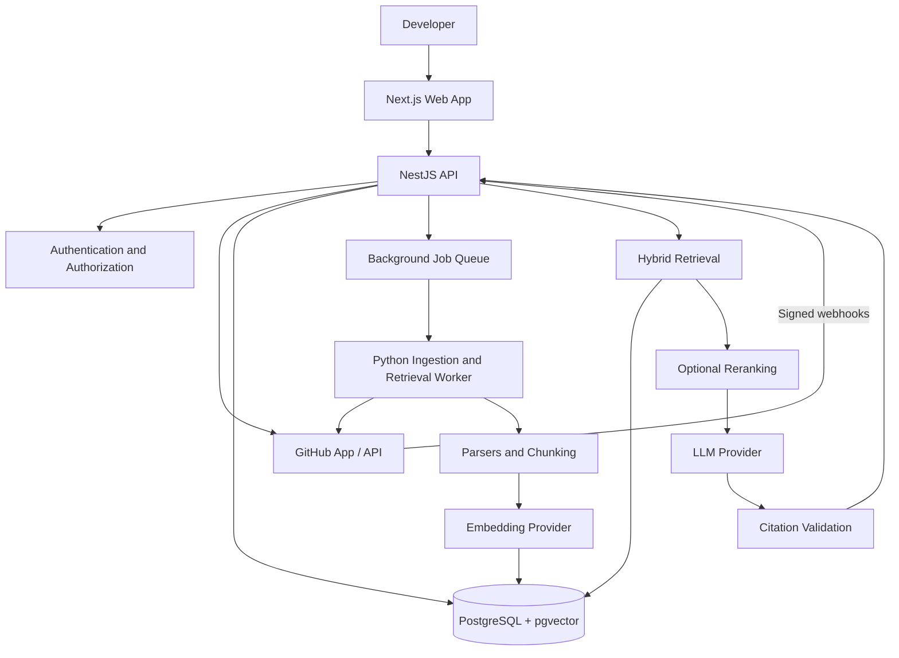

# Architecture

> Architecture baseline for the Organizational Memory Engine. This document describes the intended MVP architecture, not a claim that every component has already been implemented.

## 1. Architectural Goals

The system turns a GitHub repository and its engineering history into a searchable, source-grounded knowledge system.

The architecture prioritizes:

- Reliable answers grounded in repository evidence.
- Verifiable citations to source paths, line ranges, and commits.
- Incremental indexing as repositories change.
- Strict workspace and repository authorization.
- Clear separation between source facts, historical evidence, and model-generated inference.
- A modular implementation that can evolve without premature service decomposition.

## 2. High-Level System



The diagram represents logical responsibilities. The MVP should begin as a modular application with a background ingestion worker. Split components into independently deployed services only when operational needs justify it.

## 3. Technology Baseline

| Layer | Proposed technology | Responsibility |
|---|---|---|
| Web application | Next.js, TypeScript | Workspace, repositories, search/chat, citations, file preview, dependency view |
| UI | Tailwind CSS and accessible component system | Responsive and keyboard-accessible interface |
| Backend API | NestJS, TypeScript | Auth, GitHub authorization, access control, orchestration, query and sync APIs |
| Ingestion/retrieval | Python with LlamaIndex or comparable modular framework | Parsing, chunking, embeddings, retrieval, context construction |
| Primary database | PostgreSQL | Users, workspaces, repositories, documents, jobs, permissions, audit/query metadata |
| Vector search | pgvector | Embedding storage and semantic retrieval |
| Queue | Background job queue (implementation choice to be confirmed) | Asynchronous ingestion and synchronization |
| Source integration | GitHub API and webhooks | Repository files, commits, issues, pull requests, events |
| AI providers | Provider-neutral LLM and embedding interfaces | Generation and embeddings |

Do not treat optional technologies as implementation commitments until they are selected and validated in the repository.

## 4. Main Components

### 4.1 Web application

The frontend provides:

- Workspace and membership views.
- Connected repository list and repository overview.
- Repository authorization and connection flow.
- Indexing progress, current indexed commit, skipped files, and errors.
- Search and conversational question interface.
- Answers with citations and source snippets.
- File preview and citation navigation.
- Basic dependency/change-impact view for supported languages.
- Sync history and settings.

The UI must visibly distinguish:

1. **Source fact** — directly supported by repository content.
2. **Historical evidence** — supported by issues, pull requests, commits, or design records.
3. **Inference** — generated from relationships or incomplete evidence and labeled with uncertainty.

### 4.2 Backend API

NestJS owns application-level orchestration and authorization.

Responsibilities:

- Authentication and session handling.
- GitHub App/OAuth authorization and repository connection.
- Workspace membership and repository access checks.
- Ingestion job creation and status reporting.
- Query and search endpoints.
- Sync orchestration and webhook processing.
- Rate limiting, quotas, and audit events.
- Validation of request and model-facing response contracts.

GitHub webhook signatures must be verified before events are accepted. Every API operation must enforce workspace and repository access.

### 4.3 Ingestion and retrieval worker

The Python worker handles compute-intensive ingestion and retrieval tasks:

- Fetch authorized source content and supported engineering records.
- Identify supported and excluded file types.
- Parse content and record parser failures.
- Chunk documents while preserving useful source boundaries.
- Attach repository, path, branch/commit, language, and line-range metadata.
- Generate embeddings through a provider-neutral adapter.
- Persist document, chunk, and embedding records.
- Extract supported symbols and relationships.
- Support incremental updates and deletion/invalidation of stale records.

For code, use language-aware chunking where feasible. Avoid splitting functions and classes arbitrarily.

### 4.4 GitHub integration

Use the GitHub API for repository metadata, files, commits, pull requests, issues, and webhooks, limited to the permissions granted by the user.

The integration must:

- Request least-privilege permissions.
- Record the repository identity and granted access.
- Track the commit SHA being indexed.
- Handle API rate limits and transient failures.
- Verify webhook signatures in the API.
- Avoid fetching or exposing repositories the user has not authorized.

### 4.5 Storage

PostgreSQL is the initial system of record. pgvector stores embeddings alongside relational metadata.

Use object storage only if raw files or large artifacts need persistence. Avoid unnecessary duplication of repository contents.

A dedicated graph database is not part of the initial architecture. Start with relational relationship tables and evaluate graph-specific storage only if measured query requirements justify it.

## 5. Ingestion Workflow

1. User connects a GitHub repository and grants the required permissions.
2. API verifies access and creates a repository connection.
3. System resolves and records the target commit SHA.
4. API schedules an ingestion job.
5. Worker fetches eligible files and supported engineering records.
6. Worker filters excluded content and records skipped items.
7. Worker parses documents and records parser errors explicitly.
8. Worker creates chunks with stable identifiers and source metadata.
9. Worker generates embeddings and stores them with model/version metadata.
10. Worker extracts supported code symbols and relationships.
11. Worker records completion status and the indexed commit.
12. UI displays indexing status, errors, and the last successfully indexed commit.

A partial ingestion must be represented as partial; it must not be reported as a fully successful index.

## 6. Query and Retrieval Workflow

1. Authenticate the user.
2. Authorize access to the requested workspace and repository.
3. Resolve the indexed commit and freshness state.
4. Parse the question and determine relevant search scope.
5. Retrieve candidates using keyword and vector search.
6. Apply repository, branch/commit, file-type, and access-scope filters.
7. Rerank candidates when evaluation demonstrates a benefit.
8. Construct a context window with source metadata.
9. Generate an answer with structured claim-to-source citations.
10. Validate every citation against retrieved records and the indexed commit.
11. Return the answer, citations, freshness state, and limitations.

If evidence is insufficient, the system must say so rather than inventing an answer.

## 7. Incremental Synchronization

Repository changes can trigger synchronization through verified GitHub webhooks or a manual refresh.

For each sync:

- Identify the new target commit.
- Determine changed, added, renamed, and deleted files where possible.
- Reprocess affected content rather than rebuilding the entire index unnecessarily.
- Invalidate stale chunks, embeddings, symbols, relationships, and summaries.
- Preserve commit/version metadata needed to explain which repository state supports an answer.
- Record failures and allow safe retry.
- Update the visible last-synced commit only when the corresponding state is actually indexed.

A query against a stale or partially indexed repository must expose that freshness limitation.

## 8. Core Data Model

| Entity | Purpose |
|---|---|
| Workspace | Owner, membership, and settings |
| RepositoryConnection | GitHub installation/repository IDs, permissions, and sync configuration |
| SyncJob | Requested/completed commits, status, progress, errors, timestamps |
| SourceDocument | Path, type, content hash, commit SHA, language, ingestion status |
| Chunk | Document reference, content, chunking metadata, source line range |
| Embedding | Vector, model/version, associated chunk |
| CodeSymbol | Optional function, class, or module metadata |
| CodeRelationship | Source symbol, relationship type, target symbol, extraction method, confidence/evidence |
| QuerySession | User, repository, question, timestamp, model/config versions |
| Citation | Answer claim linked to source document, line range, and commit |
| AuditEvent | Security-relevant and administrative actions |

Use stable IDs and content hashes. Track embedding model, parser, and chunking versions so content can be re-indexed when processing behavior changes.

## 9. Code Relationships and Change Impact

Begin with a limited set of supported languages and relationship types:

- Imports/includes.
- Function/method calls where statically discoverable.
- Class/interface implementation.
- Configuration references.
- API route-to-handler mappings.
- Test-to-implementation links.
- Documentation links to code symbols.

For a change-impact query:

1. Identify the target file or symbol.
2. Retrieve direct references and supported dependency edges.
3. Retrieve related tests and configuration.
4. Explain likely impact with evidence.
5. Mark incomplete language coverage and dynamic relationships.
6. Avoid presenting static analysis as a complete runtime call graph.

Every relationship should record its extraction method and available confidence/evidence.

## 10. API Boundary Suggestions

Exact routes and schemas should follow the implementation, but the backend will need interfaces for:

- Authentication and GitHub connection.
- Workspace and repository management.
- Repository sync initiation and status.
- Keyword/semantic search.
- Question submission and answer retrieval.
- Citation/source inspection.
- Dependency and change-impact queries.
- Audit and settings operations.

Validate input and output at boundaries. Shared API contracts may live in a dedicated package if that fits the repository structure.

## 11. Suggested Repository Structure

```text
apps/
  web/                    # Next.js UI
  api/                    # NestJS API
services/
  retrieval/               # Python ingestion and retrieval worker
packages/
  contracts/               # Shared API/schema definitions, if useful
  config/                  # Shared lint/type configuration, if useful
infra/
  docker/                  # Local development services
docs/
  architecture.md
  evaluation.md
  data-and-privacy.md
  decisions/
```

This is a starting point, not a requirement to create every folder immediately.

## 12. Reliability and Operational Requirements

- Use structured logs and correlation IDs.
- Do not log credentials, tokens, or unnecessary private source content.
- Make ingestion jobs retryable and idempotent where practical.
- Track job progress, parser failures, and rate-limit responses.
- Add health checks for application and worker processes.
- Apply rate limits and quotas to ingestion and queries.
- Monitor query latency, ingestion duration, failure rates, and provider usage.
- Keep model, embedding, parser, and chunking versions visible in operational metadata.

## 13. Architecture Decisions and Constraints

- Start with a modular application and background worker.
- Use PostgreSQL and pgvector before considering a dedicated vector or graph database.
- Keep LLM and embedding providers behind provider-neutral interfaces.
- Prefer deterministic parsing and metadata filters when they outperform model guesses.
- Do not execute repository code during ingestion.
- Do not introduce a complex agent framework without a demonstrated requirement.
- Do not implement automatic code modification or merging in the MVP.
- Inspect the existing repository before assuming any component, schema, or integration exists.

## 14. MVP Architecture Acceptance Criteria

The architecture is sufficient for an MVP demonstration when a user can:

- Connect a test GitHub repository with limited permissions.
- Index supported files at a known commit.
- Search by keyword and semantic meaning.
- Ask a repository question and receive a grounded answer with valid citations.
- Open citations and verify the supporting source.
- Receive an honest insufficient-evidence response.
- Inspect basic dependency/change-impact information with clear limitations.
- Make a commit and see changed content indexed incrementally.
- See ingestion failures and stale status.
- Reproduce the workflow from documented setup instructions.
