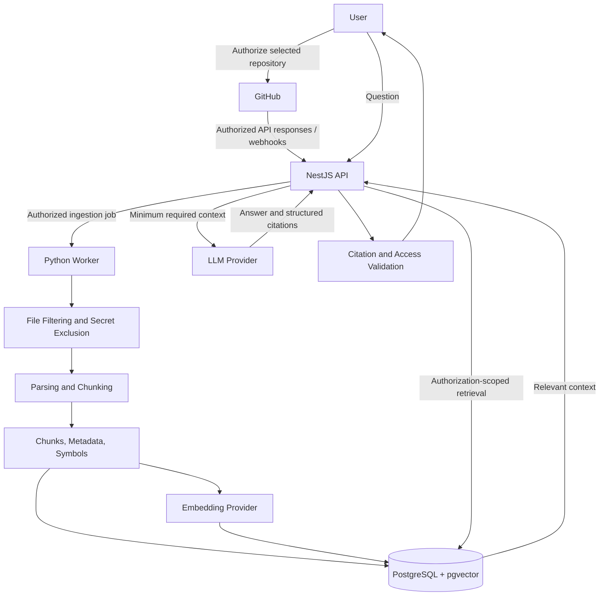

# Data and Privacy

> This document describes the intended data-handling and security requirements for the Organizational Memory Engine. Actual retention periods, provider settings, and legal obligations must be confirmed before production use.

## 1. Purpose and Scope

The Organizational Memory Engine connects to GitHub repositories and processes source code, documentation, issues, pull requests, commits, and architecture records to provide repository-aware answers with traceable evidence.

Repository content can be private and commercially sensitive. The system must therefore treat source material, metadata, embeddings, generated answers, and access tokens as protected data.

This document covers:

- Data collected and processed.
- GitHub authorization.
- Storage and indexing.
- AI provider data flow.
- Workspace and repository isolation.
- Prompt-injection risks.
- Logging, retention, deletion, and user controls.
- Operational security requirements.

It does not claim that a particular legal or regulatory compliance certification has been achieved.

## 2. Data Categories

| Data category | Examples | Handling requirement |
|---|---|---|
| Account data | User identity and authentication metadata | Store only what is required for account and access management |
| Workspace data | Owner, members, settings | Enforce workspace membership checks |
| Repository metadata | Repository ID, name, permissions, default branch | Restrict to authorized workspaces |
| Source content | Code, README files, supported documentation | Index only eligible content from authorized repositories |
| Engineering history | Commits, issues, pull requests, comments, design records | Respect granted GitHub permissions and source visibility |
| Derived content | Chunks, embeddings, symbols, relationships, summaries | Apply the same repository access restrictions as the source |
| Query data | Questions, retrieved evidence, generated answers, citations | Restrict access and minimize unnecessary retention |
| Operational data | Sync jobs, errors, audit events, usage metrics | Avoid credentials and unnecessary source content |
| Credentials | OAuth tokens, GitHub installation credentials, secrets | Store securely; never include in prompts, embeddings, citations, or logs |

## 3. Data Collection and Authorization

### 3.1 GitHub connection

- Use GitHub sign-in and the selected GitHub integration mechanism.
- Request the minimum permissions required for the features enabled.
- Explain requested permissions to the user.
- Allow users to choose which repositories to connect.
- Do not index private repositories without explicit authorization.
- Record the repository identity and granted permission scope.
- Re-check authorization when processing requests and synchronization events.

### 3.2 Access enforcement

Every request that reads repository content or derived data must verify:

1. The user is authenticated.
2. The user belongs to the relevant workspace.
3. The workspace is connected to the repository.
4. The repository connection is active and authorized.
5. The requested resource belongs to that repository and permitted scope.

Enforce these checks in both the API and retrieval layer. Never rely only on frontend visibility or a client-supplied repository ID.

## 4. Data Flow

The AI provider receives only the context required to answer a query. Provider-specific retention, training, and data-processing behavior must be reviewed and documented before enabling that provider for private repositories.

## 5. Storage and Isolation

### 5.1 Primary storage

PostgreSQL stores:

- Users and workspace membership.
- Repository connections and permissions.
- Sync jobs and ingestion status.
- Source-document metadata.
- Chunks and source line ranges.
- Embeddings through pgvector.
- Symbols and code relationships.
- Query sessions and citations.
- Audit events.

Object storage may be used for raw files or large artifacts only when needed. Avoid unnecessary duplication of repository contents.

### 5.2 Tenant and repository isolation

- Associate every repository-derived record with its workspace and repository.
- Apply workspace and repository filters to all retrieval operations.
- Prevent vector search from returning chunks outside the authorized scope.
- Apply authorization before context is sent to an LLM provider.
- Test access boundaries across API, database queries, background jobs, and retrieval.
- Treat cross-tenant snippet or embedding exposure as a critical security defect.

Database-level safeguards such as row-level security may be considered, but must complement—not replace—application authorization.

## 6. Secret and Sensitive Content Handling

Repositories may contain credentials, private keys, tokens, connection strings, personal data, or other sensitive information.

The system should:

- Exclude likely secrets and sensitive generated files from indexing where feasible.
- Support configurable ignore patterns and file-size/type limits.
- Detect and redact likely credentials before content reaches embeddings or LLM prompts.
- Avoid storing detected secret values in logs or error messages.
- Avoid indexing build artifacts, binaries, dependency folders, and irrelevant generated files by default.
- Record skipped/redacted outcomes without reproducing the sensitive value.
- Provide a way to remove indexed content when a user identifies an accidental inclusion.

Secret detection is not guaranteed to catch every secret. Documentation should make this limitation clear.

## 7. AI Provider Data Handling

LLM and embedding providers must be accessed through provider-neutral interfaces.

Before enabling a provider for private repository content, document:

- Provider and model name/version.
- Data sent to the provider.
- Whether prompts or embeddings are retained by the provider.
- Whether submitted data may be used for model training.
- Available data-processing and retention controls.
- Processing region and relevant subprocessors, where applicable.
- Whether provider-side logging can be disabled or minimized.

Send only the retrieved context needed for the current task. Never send GitHub access tokens, application secrets, or unrelated repository content to a model.

Provider selection must consider privacy terms as well as quality, latency, and cost.

## 8. Prompt Injection and Untrusted Repository Content

Source files, README instructions, issues, pull-request descriptions, and comments are untrusted data. They may contain text designed to manipulate an AI model.

Required safeguards:

- Treat retrieved repository content as evidence, never as system or developer instructions.
- Do not allow repository text to override system policies, user permissions, or tool authorization.
- Clearly delimit retrieved content when constructing model context.
- Do not execute repository code during ingestion or question answering.
- Do not let model-generated tool requests bypass backend authorization.
- Validate structured model output and citation targets.
- Test with malicious instructions embedded in code comments, documentation, issue text, and pull requests.

The model must not be trusted to enforce access control by itself.

## 9. Credentials and Application Security

- Keep secrets out of source control.
- Provide placeholders only in `.env.example`.
- Store GitHub credentials and provider keys in an appropriate secret-management mechanism.
- Encrypt credentials at rest where supported by the selected storage/deployment environment.
- Use secure transport for network communication.
- Apply least-privilege service credentials.
- Rotate and revoke credentials when required.
- Never place credentials in prompts, embeddings, citations, or logs.
- Verify GitHub webhook signatures.
- Validate inputs and model outputs at system boundaries.
- Apply rate limits and quotas to ingestion and queries.
- Use structured logs and correlation IDs without recording unnecessary private content.

## 10. Logging, Monitoring, and Audit

Audit security-relevant and administrative actions, such as:

- Repository connection and disconnection.
- Permission or membership changes.
- Ingestion and synchronization requests.
- Access-denied events.
- Repository deletion requests.
- Security-sensitive configuration changes.

Operational logs should help diagnose failures without storing full private source files, credentials, or unnecessary query context.

Define access controls for logs and monitoring systems. Establish log retention based on operational needs and applicable obligations; do not assume indefinite retention.

## 11. Retention and Deletion

The product must document actual retention behavior before production use.

At minimum, support:

- Disconnecting a repository.
- Stopping future synchronization for a disconnected repository.
- Deleting indexed content associated with a repository when requested.
- Removing related chunks, embeddings, symbols, relationships, and cached/derived records.
- Handling queued jobs so deleted content is not reintroduced by an old job.
- Recording deletion completion without retaining the deleted source content.
- Explaining any backup or provider-side retention that cannot be removed immediately.

Deletion should be scoped by stable repository/workspace identifiers and should be safe to retry. Define and test the expected completion behavior.

## 12. User Transparency and Controls

The interface and documentation should explain:

- Which repositories are connected.
- What permissions were granted.
- Which content types are indexed.
- Which files or content were skipped and why.
- Which commit is currently indexed.
- Whether indexing is stale or partial.
- Which external model providers receive retrieved context.
- How to disconnect a repository and request deletion of indexed data.

Do not imply that the system indexes every file or understands every language.

## 13. Availability, Abuse, and Resource Controls

- Apply rate limits to search, question answering, and ingestion.
- Apply quotas to prevent accidental or abusive resource consumption.
- Handle GitHub API limits and provider failures gracefully.
- Make ingestion jobs retryable and idempotent where practical.
- Prevent duplicate webhook delivery from creating inconsistent indexing state.
- Expose partial failures rather than reporting false success.
- Avoid running repository code or arbitrary build scripts.
- Monitor unusual access patterns and repeated authorization failures.

## 14. Privacy and Security Test Checklist

- [ ] Private repositories are indexed only after explicit authorization.
- [ ] GitHub permissions are least-privilege for enabled functionality.
- [ ] Webhook signatures are verified.
- [ ] Every API request checks workspace and repository access.
- [ ] Retrieval filters prevent cross-repository and cross-tenant leakage.
- [ ] Background jobs re-check repository authorization before processing.
- [ ] Disconnected repositories cannot be queried or re-synced by stale jobs.
- [ ] Likely secrets are excluded or redacted where feasible.
- [ ] Credentials never appear in prompts, embeddings, citations, or logs.
- [ ] Repository prompt injection cannot override system instructions or access control.
- [ ] Repository code is never executed during ingestion.
- [ ] Citation links cannot expose inaccessible source content.
- [ ] Deletion removes indexed and derived repository data according to documented behavior.
- [ ] Provider data handling has been reviewed and documented.
- [ ] Cross-tenant authorization test failures: zero.

## 15. Open Decisions Before Production

The following decisions must be made and documented; this file does not assume answers:

- Exact GitHub App permissions and installation model.
- Authentication/session strategy and token lifecycle.
- Credential encryption and secret-management implementation.
- Supported file types, ignore rules, and secret-scanning approach.
- LLM and embedding providers and their data-processing terms.
- Whether raw source content is persisted beyond processing.
- Query, audit, backup, and derived-data retention periods.
- Deletion completion guarantees and backup expiry behavior.
- Hosting regions and subprocessors.
- Incident response and security contact process.
- Applicable privacy, contractual, and regulatory obligations.

## 16. Release Gate

Do not enable private-repository usage for a production audience until authorization isolation, credential handling, provider data flow, prompt-injection protections, and deletion behavior have been implemented and tested.

This document is a requirements baseline, not proof of security or legal compliance.
