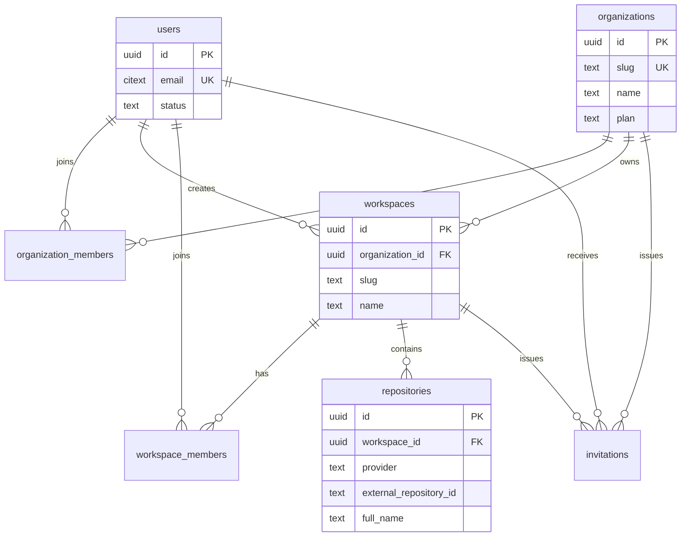

# RepoMind Database Design

> End-to-end PostgreSQL database design for RepoMind. This is the target schema for the planned product flows described in `docs/architecture.md`, `docs/api-design.md`, and `docs/data-and-privacy.md`. It is a design baseline, not a claim that these tables or migrations already exist.

## 1. Purpose and design goals

The database is the system of record for:

- User accounts, authentication identities, and sessions.
- Organizations, workspaces, memberships, invitations, and authorization.
- GitHub installations, repository connections, webhook deliveries, and sync configuration.
- Ingestion jobs and their file-level outcomes.
- Versioned source metadata, chunks, embeddings, symbols, and code relationships.
- Search/question sessions, answers, retrieval evidence, and citations.
- Settings, provider configuration metadata, usage, audit events, and deletion jobs.

The design must support these properties:

1. **Tenant isolation:** every repository-derived record is scoped to an organization, workspace, and repository where applicable.
2. **Evidence versioning:** citations always identify the repository, commit, path, and line range that supported a result.
3. **Incremental indexing:** a sync can add, update, rename, or delete only affected paths while retaining commit history needed for reproducibility.
4. **Safe retries:** webhook delivery, jobs, deletion, and indexing operations are idempotent.
5. **Explicit uncertainty:** partial indexing, stale content, parser failures, and inferred relationships are represented in data rather than hidden.
6. **Privacy by default:** credentials, raw files, prompts, and embeddings have separate handling rules and are never exposed through normal resource responses.
7. **Operational traceability:** important actions carry actor, correlation ID, provider/model versions, and timestamps.

## 2. Technology and conventions

### 2.1 Database technology

| Concern | Choice |
|---|---|
| Primary database | PostgreSQL 16+ |
| Vector search | `pgvector` extension |
| IDs | UUID generated by the database or application; public IDs are opaque |
| Time | `timestamptz` in UTC |
| Flexible settings | `jsonb`, validated at the application boundary |
| Large/raw objects | Object storage referenced by an opaque key; not normally stored in PostgreSQL |
| Migrations | Versioned, forward-only migrations with an explicit rollback strategy |
| Tenant enforcement | Application authorization plus optional PostgreSQL row-level security |

Recommended extensions:

```sql
CREATE EXTENSION IF NOT EXISTS pgcrypto; -- gen_random_uuid()
CREATE EXTENSION IF NOT EXISTS citext;   -- case-insensitive email/slug support where useful
CREATE EXTENSION IF NOT EXISTS vector;   -- pgvector
```

The exact vector dimension is deployment-specific. Do not hard-code a dimension in an early migration until the embedding model has been selected. A fixed dimension should be used once the provider is chosen, for example `vector(1536)`.

### 2.2 Common column conventions

| Column       | Type          | Rule                                                         |
| ------------ | ------------- | ------------------------------------------------------------ |
| `uid`        | `uuid`        | Primary key, opaque outside the API                          |
| `created_at` | `timestamptz` | Required, immutable creation time                            |
| `updated_at` | `timestamptz` | Required, changed by the application or trigger              |
| `deleted_at` | `timestamptz` | Nullable soft-deletion marker where recovery/audit is useful |
| `metadata`   | `jsonb`       | Non-authoritative provider or diagnostic data only           |

Use `NOT NULL` for all fields required to authorize, identify, version, or delete data. Use `CHECK` constraints for status values and numeric ranges. Do not use database enums for values expected to change frequently; use text plus a check constraint or application constants.

All foreign keys must specify an intentional delete action. Tenant-owned data should generally use restricted deletion plus an explicit deletion workflow, rather than relying on a cascading delete that can run for an unbounded amount of data.

### 2.3 Naming and privacy rules

- Table names are plural `snake_case`; columns are singular `snake_case`.
- `email` is normalized to lowercase before storage. A `citext` column or a functional unique index may enforce case-insensitive uniqueness.
- Provider IDs are stored as strings because GitHub and future providers do not share numeric ID formats.
- Token values, password hashes, embeddings, private source content, prompts, and answers are sensitive data.
- Access tokens are encrypted before persistence. A key reference and encryption version are stored with the ciphertext.
- Passwords are stored only as a memory-hard password hash such as Argon2id. Never store plaintext or reversible passwords.
- Secrets must not be copied into `metadata`, audit payloads, logs, prompts, embeddings, or error messages.

## 3. Tenant hierarchy and relationships

The target hierarchy is:



An organization is the billing and administrative boundary. A workspace is the authorization and product boundary used by the public API (`x-tenant-id` and `/workspaces/{workspaceId}`). A workspace belongs to exactly one organization in the target design. A user can belong to many organizations and workspaces.

For a small deployment, an organization and its first workspace may be created together. The schema should still retain both records so future billing, multiple workspaces, and organization-level GitHub installations do not require a tenancy migration.

## 4. Entity inventory

| Entity/table | Scope | Purpose |
|---|---|---|
| `users` | Global | Product account and profile |
| `auth_identities` | Global/user | Password or external identity mapping |
| `user_sessions` | Global/user | Refresh-token/session lifecycle |
| `organizations` | Global | Administrative and billing tenant |
| `organization_members` | Organization | Organization-level roles |
| `workspaces` | Organization | Product authorization tenant |
| `workspace_members` | Workspace | Workspace roles and access status |
| `invitations` | Organization/workspace | Pending membership invitations |
| `github_installations` | Organization | GitHub App installation and encrypted credentials |
| `repositories` | Workspace | Connected repository and visible index state |
| `repository_sync_settings` | Repository | Branch, filtering, and scheduling choices |
| `webhook_deliveries` | Repository/installation | Deduplication and webhook trace |
| `sync_jobs` | Repository | Ingestion orchestration state |
| `sync_job_files` | Sync job | Per-path processing outcome |
| `external_records` | Repository | Optional commits/issues/PRs/design records |
| `source_documents` | Repository/commit | Versioned source file metadata |
| `source_chunks` | Source document | Searchable line-ranged content units |
| `embeddings` | Chunk | Vector and embedding provenance |
| `code_symbols` | Repository/document | Extracted functions, classes, modules, and symbols |
| `code_relationships` | Repository | Evidence-backed graph edges |
| `query_sessions` | Workspace/repository | User questions and generated answers |
| `query_evidence` | Query/chunk | Retrieved candidates and ranking metadata |
| `citations` | Query | Validated claim-to-source links |
| `workspace_settings` | Workspace | Non-secret product settings |
| `provider_configs` | Workspace/organization | Provider metadata and encrypted credentials |
| `usage_records` | Organization/workspace | Metering and quota counters |
| `audit_events` | Organization/workspace | Security and administrative history |
| `deletion_jobs` | Organization/workspace/repository | Retryable data deletion workflow |
| `outbox_events` | Tenant/resource | Reliable queue/event publication |

## 5. Identity and authentication schema

### 5.1 `users`

One row represents one RepoMind account, regardless of how the user authenticates.

| Column              | Type          | Required | Description                                   |
| ------------------- | ------------- | -------: | --------------------------------------------- |
| `usid`              | `uuid`        | yes      | Primary key                                   |
| `email`             | `citext`      | yes      | Verified or pending account email; unique     |
| `email_verified_at` | `timestamptz` | no       | Time email ownership was verified             |
| `first_name`        | `text`        | no       | Display profile field                         |
| `last_name`         | `text`        | no       | Display profile field                         |
| `display_name`      | `text`        | no       | UI display name; can be derived initially     |
| `avatar_url`        | `text`        | no       | Provider avatar URL, not an access credential |
| `timezone`          | `text`        | yes      | IANA timezone, default `UTC`                  |
| `locale`            | `text`        | yes      | Locale, default `en-US`                       |
| `status`            | `text`        | yes      | `pending`, `active`, `suspended`, `deleted`   |
| `last_seen_at`      | `timestamptz` | no       | Last authenticated/request activity           |
| `created_at`        | `timestamptz` | yes      | Account creation time                         |
| `updated_at`        | `timestamptz` | yes      | Last profile change                           |
| `deleted_at`        | `timestamptz` | no       | Account deletion marker                       |

Constraints:

- `email` must be unique among non-deleted users, unless product policy deliberately permits account reuse.
- `timezone` must be a supported IANA timezone at the API boundary.
- Deleted users lose active sessions and memberships; historical audit records retain a stable actor reference or an anonymized actor label according to retention policy.

Recommended indexes:

```sql
CREATE UNIQUE INDEX users_email_active_uq
  ON users (email) WHERE deleted_at IS NULL;
CREATE INDEX users_status_idx ON users (status);
```

### 5.2 `auth_identities`

This table separates a user from the credentials used to sign in.

| Column             | Type          | Required | Description                                    |
| ------------------ | ------------- | -------: | ---------------------------------------------- |
| `uid`              | `uuid`        | yes      | Primary key                                    |
| `user_uid`         | `uuid`        | yes      | FK to `users`                                  |
| `provider`         | `text`        | yes      | `password`, `github`, or another supported IdP |
| `provider_subject` | `text`        | yes      | Stable provider subject; unique per provider   |
| `provider_login`   | `text`        | no       | GitHub login at link time                      |
| `password_hash`    | `text`        | no       | Argon2id hash; only for `provider = password`  |
| `verified_at`      | `timestamptz` | no       | Identity verification time                     |
| `last_used_at`     | `timestamptz` | no       | Last successful use                            |
| `metadata`         | `jsonb`       | yes      | Non-secret provider profile metadata           |
| `created_at`       | `timestamptz` | yes      | Creation time                                  |
| `updated_at`       | `timestamptz` | yes      | Last change                                    |

Constraints:

- Unique `(provider, provider_subject)`.
- A password identity must have `password_hash`; non-password identities must not use it.
- Do not store GitHub OAuth access tokens here. Installation or provider credentials belong in encrypted credential columns/tables.

### 5.3 `user_sessions`

Use opaque, rotating refresh tokens. Store hashes, not bearer token values.

| Column               | Type          | Required | Description                                                  |
| -------------------- | ------------- | -------: | ------------------------------------------------------------ |
| `uid`                | `uuid`        | yes      | Session primary key                                          |
| `user_uid`           | `uuid`        | yes      | Session owner                                                |
| `refresh_token_hash` | `bytea`       | yes      | Hash of current refresh token                                |
| `token_family_id`    | `uuid`        | yes      | Rotation/reuse-detection family                              |
| `user_agent`         | `text`        | no       | Truncated client metadata                                    |
| `ip_address`         | `inet`        | no       | Login IP, subject to privacy policy                          |
| `created_at`         | `timestamptz` | yes      | Session creation                                             |
| `last_used_at`       | `timestamptz` | yes      | Last refresh/use                                             |
| `expires_at`         | `timestamptz` | yes      | Absolute expiry                                              |
| `revoked_at`         | `timestamptz` | no       | Logout or security revocation                                |
| `revoke_reason`      | `text`        | no       | `logout`, `rotation_reuse`, `admin`, `account_deleted`, etc. |

Indexes:

- Unique index on `refresh_token_hash`.
- `(user_id, revoked_at, expires_at)` for active-session listing and cleanup.
- `(token_family_id)` for refresh-token reuse detection.

Access tokens should be short-lived and need not be stored if JWT validation is used. Refresh sessions must be stored and revocable.

## 6. Organization, workspace, and membership schema

### 6.1 `organizations`

| Column          | Type          | Required | Description                                  |
| --------------- | ------------- | -------: | -------------------------------------------- |
| `uid`           | `uuid`        | yes      | Primary key                                  |
| `slug`          | `citext`      | yes      | URL-safe unique identifier                   |
| `name`          | `text`        | yes      | Organization display name                    |
| `legal_name`    | `text`        | no       | Optional billing/legal name                  |
| `plan`          | `text`        | yes      | `free`, `pro`, `team`, `enterprise`          |
| `status`        | `text`        | yes      | `active`, `suspended`, `deleting`, `deleted` |
| `created_by`    | `uuid`        | yes      | User who created the organization            |
| `billing_email` | `citext`      | no       | Billing contact; not used for authorization  |
| `settings`      | `jsonb`       | yes      | Non-secret org settings                      |
| `created_at`    | `timestamptz` | yes      | Creation time                                |
| `updated_at`    | `timestamptz` | yes      | Last change                                  |
| `deleted_at`    | `timestamptz` | no       | Soft deletion marker                         |

Use a unique active slug. Organization deletion is asynchronous and must create a `deletion_jobs` row.

### 6.2 `organization_members`

| Column             | Type          | Required | Description                           |
| ------------------ | ------------- | -------: | ------------------------------------- |
| `uid`              | `uuid`        | yes      | Membership primary key                |
| `organization_uid` | `uuid`        | yes      | Organization FK                       |
| `user_id`          | `uuid`        | yes      | User FK                               |
| `role`             | `text`        | yes      | `owner`, `admin`, `member`, `billing` |
| `status`           | `text`        | yes      | `active`, `suspended`, `removed`      |
| `invited_by`       | `uuid`        | no       | Inviting user                         |
| `joined_at`        | `timestamptz` | no       | Acceptance time                       |
| `created_at`       | `timestamptz` | yes      | Membership creation                   |
| `updated_at`       | `timestamptz` | yes      | Last change                           |

Constraints:

- Unique `(organization_id, user_id)` for non-removed memberships.
- Exactly one active `owner` is required initially; ownership transfer must be transactional.
- An organization member is not automatically a member of every workspace. Workspace membership is checked separately.

### 6.3 `workspaces`

| Column             | Type          | Required | Description                                    |
| ------------------ | ------------- | -------: | ---------------------------------------------- |
| `uid`              | `uuid`        | yes      | API tenant ID and primary key                  |
| `organization_uid` | `uuid`        | yes      | Parent organization                            |
| `slug`             | `citext`      | yes      | URL-safe identifier unique within organization |
| `name`             | `text`        | yes      | Workspace display name                         |
| `description`      | `text`        | no       | Optional description                           |
| `status`           | `text`        | yes      | `active`, `suspended`, `deleting`, `deleted`   |
| `created_by`       | `uuid`        | yes      | Creator                                        |
| `default_branch`   | `text`        | no       | Default branch preference for new repositories |
| `settings_version` | `integer`     | yes      | Settings schema version, default `1`           |
| `created_at`       | `timestamptz` | yes      | Creation time                                  |
| `updated_at`       | `timestamptz` | yes      | Last change                                    |
| `deleted_at`       | `timestamptz` | no       | Soft deletion marker                           |

Unique active key: `(organization_id, slug)`.

### 6.4 `workspace_members`

| Column             | Type          | Required | Description                                          |
| ------------------ | ------------- | -------: | ---------------------------------------------------- |
| `uid`              | `uuid`        | yes      | Membership primary key                               |
| `workspace_uid`    | `uuid`        | yes      | Workspace FK                                         |
| `user_uid`         | `uuid`        | yes      | User FK                                              |
| `role`             | `text`        | yes      | `owner`, `admin`, `member`, `viewer`                 |
| `status`           | `text`        | yes      | `invited`, `active`, `suspended`, `removed`          |
| `source`           | `text`        | yes      | `organization`, `direct_invite`, `created_workspace` |
| `invited_by`       | `uuid`        | no       | Inviter                                              |
| `joined_at`        | `timestamptz` | no       | Acceptance time                                      |
| `last_accessed_at` | `timestamptz` | no       | Last workspace access                                |
| `created_at`       | `timestamptz` | yes      | Creation time                                        |
| `updated_at`       | `timestamptz` | yes      | Last change                                          |

Unique active key: `(workspace_id, user_id)` where `status <> 'removed'`. Every workspace must have at least one active owner. Role changes and removals must be audited.

### 6.5 `invitations`

| Column             | Type          | Required | Description                      |
| ------------------ | ------------- | -------: | -------------------------------- |
| `uid`              | `uuid`        | yes      | Invitation primary key           |
| `organization_uid` | `uuid`        | no       | Organization invitation scope    |
| `workspace_uid`    | `uuid`        | no       | Workspace invitation scope       |
| `email`            | `citext`      | yes      | Invite target                    |
| `role`             | `text`        | yes      | Role granted when accepted       |
| `token_hash`       | `bytea`       | yes      | Single-use invitation token hash |
| `invited_by`       | `uuid`        | yes      | Actor                            |
| `accepted_by`      | `uuid`        | no       | User who accepted                |
| `expires_at`       | `timestamptz` | yes      | Expiry                           |
| `accepted_at`      | `timestamptz` | no       | Acceptance time                  |
| `revoked_at`       | `timestamptz` | no       | Revocation time                  |
| `created_at`       | `timestamptz` | yes      | Creation time                    |

Exactly one of `organization_id` and `workspace_id` is required. A workspace invitation must not bypass organization membership policy if the product requires organization membership.

## 7. GitHub integration and repository schema

### 7.1 `github_installations`

Store one row per GitHub App installation or equivalent authorization grant.

| Column                   | Type          | Required | Description                                                 |
| ------------------------ | ------------- | -------: | ----------------------------------------------------------- |
| `uid`                    | `uuid`        | yes      | Internal ID                                                 |
| `organization_uid`       | `uuid`        | yes      | Owning organization                                         |
| `github_installation_id` | `text`        | yes      | Stable GitHub installation ID                               |
| `github_account_id`      | `text`        | yes      | GitHub user/org account ID                                  |
| `github_account_login`   | `text`        | yes      | Login at last sync                                          |
| `github_account_type`    | `text`        | yes      | `User` or `Organization`                                    |
| `encrypted_access_token` | `bytea`       | no       | Encrypted credential, if the selected integration needs one |
| `encryption_key_ref`     | `text`        | no       | Secret-manager/KMS key reference                            |
| `encryption_version`     | `integer`     | no       | Ciphertext format version                                   |
| `permissions`            | `jsonb`       | yes      | Granted permission names and levels, no token values        |
| `status`                 | `text`        | yes      | `active`, `revoked`, `reauthorization_required`, `deleted`  |
| `last_validated_at`      | `timestamptz` | no       | Last successful authorization check                         |
| `created_at`             | `timestamptz` | yes      | Creation time                                               |
| `updated_at`             | `timestamptz` | yes      | Last change                                                 |

Unique `(organization_id, github_installation_id)` and globally unique provider installation ID where GitHub guarantees it.

### 7.2 `repositories`

This is the connected repository record, not a copy of repository contents.

| Column                   | Type          | Required | Description                                               |
| ------------------------ | ------------- | -------: | --------------------------------------------------------- |
| `uid`                    | `uuid`        | yes      | Internal repository ID                                    |
| `workspace_uid`          | `uuid`        | yes      | Authorization tenant                                      |
| `github_installation_id` | `uuid`        | yes      | Installation used to access it                            |
| `provider`               | `text`        | yes      | `github` initially                                        |
| `external_repository_id` | `text`        | yes      | GitHub repository ID                                      |
| `owner_login`            | `text`        | yes      | GitHub owner/org login                                    |
| `name`                   | `text`        | yes      | Repository name                                           |
| `full_name`              | `text`        | yes      | `owner/name`                                              |
| `html_url`               | `text`        | no       | Provider URL                                              |
| `default_branch`         | `text`        | yes      | Current provider default branch                           |
| `visibility`             | `text`        | yes      | `public`, `private`, `internal`                           |
| `is_fork`                | `boolean`     | yes      | Provider fork flag                                        |
| `connection_status`      | `text`        | yes      | `active`, `paused`, `revoked`, `disconnecting`, `deleted` |
| `indexed_commit_sha`     | `text`        | no       | Last fully or explicitly partially visible indexed commit |
| `indexed_commit_status`  | `text`        | yes      | `none`, `current`, `stale`, `partial`, `deleting`         |
| `last_sync_started_at`   | `timestamptz` | no       | Most recent sync start                                    |
| `last_sync_completed_at` | `timestamptz` | no       | Most recent terminal sync                                 |
| `last_sync_error`        | `text`        | no       | Safe summary; never include secrets/source content        |
| `created_by`             | `uuid`        | yes      | User who connected it                                     |
| `created_at`             | `timestamptz` | yes      | Connection time                                           |
| `updated_at`             | `timestamptz` | yes      | Last metadata/status change                               |
| `deleted_at`             | `timestamptz` | no       | Disconnect deletion marker                                |

Unique `(workspace_id, provider, external_repository_id)` for active connections. Also maintain a unique provider repository identity per workspace to prevent duplicate connections.

### 7.3 `repository_sync_settings`

Keep frequently changed sync preferences separate from repository identity.

| Column | Type | Required | Description |
|---|---|---:|---|
| `repository_id` | `uuid` | yes | Primary key and FK |
| `branch` | `text` | yes | Branch to index |
| `include_history` | `boolean` | yes | Whether commits/issues/PRs are ingested |
| `include_issues` | `boolean` | yes | Issue ingestion flag |
| `include_pull_requests` | `boolean` | yes | PR ingestion flag |
| `ignore_patterns` | `jsonb` | yes | Ordered glob patterns |
| `allowed_file_types` | `jsonb` | yes | Optional file-type allowlist |
| `max_file_bytes` | `bigint` | yes | File size ceiling |
| `secret_scan_mode` | `text` | yes | `skip`, `redact`, `allow_with_warning` |
| `auto_sync_enabled` | `boolean` | yes | Webhook/manual sync behavior |
| `updated_by` | `uuid` | yes | Last settings actor |
| `created_at` | `timestamptz` | yes | Creation time |
| `updated_at` | `timestamptz` | yes | Last change |

Patterns and limits must be validated before a sync starts. Secrets and raw tokens do not belong in this table.

### 7.4 `webhook_deliveries`

| Column | Type | Required | Description |
|---|---|---:|---|
| `id` | `uuid` | yes | Internal ID |
| `github_installation_id` | `uuid` | no | Resolved installation |
| `repository_id` | `uuid` | no | Resolved repository |
| `delivery_id` | `text` | yes | GitHub delivery ID, unique |
| `event_name` | `text` | yes | Webhook event type |
| `payload_sha256` | `text` | yes | Digest for diagnostics, not raw payload |
| `signature_verified_at` | `timestamptz` | no | Verification time |
| `status` | `text` | yes | `received`, `ignored`, `queued`, `processed`, `failed` |
| `error_code` | `text` | no | Safe processing error |
| `received_at` | `timestamptz` | yes | Arrival time |
| `processed_at` | `timestamptz` | no | Terminal processing time |

The unique delivery ID makes duplicate webhook processing safe. Do not persist the full webhook payload unless a documented, protected retention policy requires it.

## 8. Synchronization and ingestion schema

### 8.1 `sync_jobs`

| Column | Type | Required | Description |
|---|---|---:|---|
| `id` | `uuid` | yes | Job ID exposed by the API |
| `workspace_id` | `uuid` | yes | Tenant scope |
| `repository_id` | `uuid` | yes | Repository scope |
| `requested_by` | `uuid` | no | User or system actor |
| `trigger` | `text` | yes | `manual`, `webhook`, `scheduled`, `retry`, `initial` |
| `mode` | `text` | yes | `full`, `incremental`, `deletion` |
| `status` | `text` | yes | `queued`, `running`, `partial`, `succeeded`, `failed`, `cancelled` |
| `job_key` | `text` | yes | Idempotency key |
| `base_commit_sha` | `text` | no | Previously indexed commit |
| `requested_commit_sha` | `text` | yes | Target commit |
| `indexed_commit_sha` | `text` | no | Commit actually processed |
| `progress` | `numeric(5,4)` | yes | Range `0.0000`–`1.0000` |
| `total_files` | `integer` | yes | Planned file count |
| `processed_files` | `integer` | yes | Processed count |
| `skipped_files` | `integer` | yes | Excluded/skipped count |
| `failed_files` | `integer` | yes | Failed count |
| `worker_version` | `text` | no | Worker release |
| `parser_version` | `text` | no | Parser release |
| `chunking_version` | `text` | no | Chunker release |
| `embedding_model` | `text` | no | Model identifier/version |
| `error_summary` | `text` | no | Safe terminal summary |
| `started_at` | `timestamptz` | no | Start time |
| `completed_at` | `timestamptz` | no | Terminal time |
| `created_at` | `timestamptz` | yes | Creation time |
| `updated_at` | `timestamptz` | yes | Last state change |

Unique `(repository_id, job_key)`. Only one active full/incremental job should normally run per repository; use a database lock or an active-job partial unique index.

### 8.2 `sync_job_files`

This table keeps file-level progress and parser outcomes without retaining a full source payload.

| Column | Type | Required | Description |
|---|---|---:|---|
| `id` | `uuid` | yes | Primary key |
| `sync_job_id` | `uuid` | yes | Job FK |
| `path` | `text` | yes | Repository-relative normalized path |
| `previous_path` | `text` | no | Rename source path |
| `change_type` | `text` | yes | `added`, `modified`, `renamed`, `deleted`, `unchanged` |
| `content_hash` | `text` | no | Hash of accepted content |
| `status` | `text` | yes | `queued`, `processing`, `indexed`, `skipped`, `failed`, `deleted` |
| `skip_reason` | `text` | no | `ignored_pattern`, `binary`, `too_large`, `secret`, etc. |
| `error_code` | `text` | no | Stable parser/filter error code |
| `error_message` | `text` | no | Redacted safe error |
| `started_at` | `timestamptz` | no | Processing start |
| `completed_at` | `timestamptz` | no | Processing end |

Unique `(sync_job_id, path)`. Index `(sync_job_id, status)` for progress polling.

### 8.3 `external_records`

This optional table stores metadata for GitHub history used as evidence. Full issue/PR bodies should be stored only if the retention and privacy policy permits it.

| Column | Type | Required | Description |
|---|---|---:|---|
| `id` | `uuid` | yes | Primary key |
| `workspace_id` | `uuid` | yes | Tenant scope |
| `repository_id` | `uuid` | yes | Repository scope |
| `record_type` | `text` | yes | `commit`, `issue`, `pull_request`, `review`, `design_record` |
| `external_id` | `text` | yes | Provider record ID |
| `external_url` | `text` | no | Provider URL |
| `title` | `text` | no | Display title |
| `author_login` | `text` | no | Provider author handle |
| `occurred_at` | `timestamptz` | no | Provider event time |
| `commit_sha` | `text` | no | Relevant commit |
| `content_hash` | `text` | no | Hash of retained normalized content |
| `content` | `text` | no | Optional retained content; protected |
| `visibility_status` | `text` | yes | `active`, `redacted`, `deleted` |
| `metadata` | `jsonb` | yes | Labels, state, changed-file summaries |
| `created_at` | `timestamptz` | yes | First seen |
| `updated_at` | `timestamptz` | yes | Last provider update |

Unique `(repository_id, record_type, external_id)`.

## 9. Source, chunk, embedding, and code-understanding schema

### 9.1 `source_documents`

A source document is one path at one commit. This versioned model prevents a citation to an old commit from silently resolving to current file contents.

| Column | Type | Required | Description |
|---|---|---:|---|
| `id` | `uuid` | yes | Source ID used by citations |
| `workspace_id` | `uuid` | yes | Tenant scope |
| `repository_id` | `uuid` | yes | Repository scope |
| `sync_job_id` | `uuid` | yes | Job that produced it |
| `path` | `text` | yes | Normalized repository-relative path |
| `path_hash` | `text` | yes | Hash for efficient equality/filtering |
| `branch` | `text` | no | Branch at ingestion |
| `commit_sha` | `text` | yes | Exact source commit |
| `source_type` | `text` | yes | `code`, `documentation`, `config`, `issue`, `pull_request`, `other` |
| `language` | `text` | no | Detected language |
| `mime_type` | `text` | no | Detected MIME type |
| `content_hash` | `text` | yes | Content digest |
| `byte_size` | `bigint` | yes | Size before processing |
| `line_count` | `integer` | no | Number of lines when text |
| `storage_key` | `text` | no | Object-store key if raw content is retained |
| `ingestion_status` | `text` | yes | `indexed`, `partial`, `skipped`, `failed`, `deleted` |
| `skip_reason` | `text` | no | Safe reason for exclusion |
| `parser_name` | `text` | no | Parser used |
| `parser_version` | `text` | no | Parser version |
| `redaction_status` | `text` | yes | `none`, `redacted`, `excluded` |
| `created_at` | `timestamptz` | yes | Version creation time |
| `updated_at` | `timestamptz` | yes | Metadata change time |
| `deleted_at` | `timestamptz` | no | Deletion marker |

Unique `(repository_id, commit_sha, path)`. Index `(workspace_id, repository_id, commit_sha, path)` for citation validation and `(repository_id, path, created_at desc)` for history.

Raw file content is intentionally not a required column. If it is persisted in object storage, `storage_key` must be opaque and access must be authorized through the API; it must not be a publicly readable URL.

### 9.2 `source_chunks`

Chunks are the retrieval unit and retain source location metadata.

| Column | Type | Required | Description |
|---|---|---:|---|
| `id` | `uuid` | yes | Chunk ID |
| `workspace_id` | `uuid` | yes | Tenant scope for defense-in-depth filtering |
| `repository_id` | `uuid` | yes | Repository scope |
| `source_document_id` | `uuid` | yes | Source document FK |
| `chunk_index` | `integer` | yes | Stable order within document |
| `chunk_key` | `text` | yes | Deterministic key from document/hash/index/version |
| `content` | `text` | yes | Redacted searchable chunk content |
| `content_hash` | `text` | yes | Chunk content digest |
| `start_line` | `integer` | no | Inclusive source line |
| `end_line` | `integer` | no | Inclusive source line |
| `start_byte` | `integer` | no | Optional source byte offset |
| `end_byte` | `integer` | no | Optional source byte offset |
| `token_count` | `integer` | no | Approximate model token count |
| `symbol_name` | `text` | no | Primary symbol if known |
| `chunking_strategy` | `text` | yes | `language_aware`, `line_window`, `paragraph`, etc. |
| `chunking_version` | `text` | yes | Chunker version |
| `status` | `text` | yes | `active`, `stale`, `deleted` |
| `metadata` | `jsonb` | yes | Non-authoritative parser metadata |
| `created_at` | `timestamptz` | yes | Creation time |
| `updated_at` | `timestamptz` | yes | Last change |

Constraints:

- `start_line <= end_line` when both exist.
- `chunk_index >= 0` and `token_count >= 0` when present.
- Unique `(source_document_id, chunk_index, chunking_version)`.
- Content must be filtered/redacted before insertion. Embeddings must never be generated from a content version that was later marked secret-excluded.

### 9.3 `embeddings`

Keep embedding provenance separate so a chunk can be re-embedded with a new model without losing prior evaluation data.

| Column | Type | Required | Description |
|---|---|---:|---|
| `id` | `uuid` | yes | Primary key |
| `workspace_id` | `uuid` | yes | Tenant scope |
| `repository_id` | `uuid` | yes | Repository scope |
| `chunk_id` | `uuid` | yes | Chunk FK |
| `provider` | `text` | yes | Embedding provider name |
| `model` | `text` | yes | Model name/version |
| `dimensions` | `integer` | yes | Vector dimension |
| `embedding` | `vector` | yes | pgvector value; use fixed dimension after model selection |
| `content_hash` | `text` | yes | Hash embedded, must match chunk version |
| `normalization` | `text` | no | Vector normalization method |
| `status` | `text` | yes | `active`, `superseded`, `deleted` |
| `created_at` | `timestamptz` | yes | Generation time |
| `updated_at` | `timestamptz` | yes | Status change time |

Unique active key `(chunk_id, provider, model)`. Add an HNSW or IVFFlat index only after measuring the selected distance operator and workload. Always filter by `workspace_id`, `repository_id`, and active status before vector ranking.

### 9.4 `code_symbols`

| Column | Type | Required | Description |
|---|---|---:|---|
| `id` | `uuid` | yes | Symbol ID |
| `workspace_id` | `uuid` | yes | Tenant scope |
| `repository_id` | `uuid` | yes | Repository scope |
| `source_document_id` | `uuid` | yes | Defining document |
| `stable_key` | `text` | yes | Parser-derived identity within repository/version |
| `qualified_name` | `text` | yes | Fully qualified name when available |
| `simple_name` | `text` | yes | Local symbol name |
| `symbol_type` | `text` | yes | `module`, `class`, `interface`, `function`, `method`, `constant`, `route`, `test`, etc. |
| `language` | `text` | no | Language |
| `signature` | `text` | no | Redacted/normalized signature |
| `start_line` | `integer` | no | Inclusive line |
| `end_line` | `integer` | no | Inclusive line |
| `start_column` | `integer` | no | Optional column |
| `end_column` | `integer` | no | Optional column |
| `parser_name` | `text` | yes | Extraction implementation |
| `parser_version` | `text` | yes | Extraction version |
| `status` | `text` | yes | `active`, `stale`, `deleted` |
| `metadata` | `jsonb` | yes | Non-authoritative symbol details |
| `created_at` | `timestamptz` | yes | Creation time |
| `updated_at` | `timestamptz` | yes | Last change |

Use `(repository_id, stable_key, source_document_id)` as a deduplication key. Do not treat `stable_key` as a permanent identity across arbitrary renames unless the parser can prove that identity.

### 9.5 `code_relationships`

| Column | Type | Required | Description |
|---|---|---:|---|
| `id` | `uuid` | yes | Relationship ID |
| `workspace_id` | `uuid` | yes | Tenant scope |
| `repository_id` | `uuid` | yes | Repository scope |
| `source_symbol_id` | `uuid` | yes | Source symbol |
| `target_symbol_id` | `uuid` | no | Target symbol when resolved |
| `target_path` | `text` | no | Unresolved target path |
| `relationship_type` | `text` | yes | `imports`, `calls`, `implements`, `configures`, `route_handles`, `tests`, `documents` |
| `commit_sha` | `text` | yes | Commit where edge was extracted |
| `extraction_method` | `text` | yes | Parser/static analysis method |
| `confidence` | `numeric(5,4)` | no | Range `0`–`1` |
| `evidence_chunk_id` | `uuid` | no | Supporting chunk |
| `status` | `text` | yes | `active`, `stale`, `deleted` |
| `metadata` | `jsonb` | yes | Evidence details and limitations |
| `created_at` | `timestamptz` | yes | Creation time |
| `updated_at` | `timestamptz` | yes | Last change |

At least one of `target_symbol_id` and `target_path` is required. Relationships are evidence-backed static analysis, not a complete runtime call graph.

## 10. Queries, retrieval evidence, and citations

### 10.1 `query_sessions`

One row represents one submitted question and its answer lifecycle.

| Column | Type | Required | Description |
|---|---|---:|---|
| `id` | `uuid` | yes | Query ID |
| `workspace_id` | `uuid` | yes | Authorization scope |
| `repository_id` | `uuid` | yes | Repository queried |
| `user_id` | `uuid` | yes | Requesting user |
| `question` | `text` | yes | User question; protected query data |
| `mode` | `text` | yes | `keyword`, `semantic`, `hybrid`, `question` |
| `scope` | `jsonb` | yes | Branch, file types, paths, filters |
| `requested_commit_sha` | `text` | no | User requested version |
| `indexed_commit_sha` | `text` | no | Version used for retrieval |
| `freshness` | `text` | yes | `current`, `stale`, `partial` |
| `status` | `text` | yes | `queued`, `retrieving`, `generating`, `completed`, `failed`, `cancelled` |
| `answer` | `text` | no | Generated answer, if retained |
| `insufficient_evidence` | `boolean` | yes | Grounding result |
| `limitations` | `jsonb` | yes | User-visible limitations |
| `retrieval_model` | `text` | no | Retrieval/reranker version |
| `answer_provider` | `text` | no | LLM provider |
| `answer_model` | `text` | no | LLM model/version |
| `prompt_version` | `text` | no | Prompt/template version |
| `correlation_id` | `text` | no | Request trace ID |
| `created_at` | `timestamptz` | yes | Submission time |
| `completed_at` | `timestamptz` | no | Completion time |
| `updated_at` | `timestamptz` | yes | Last state change |

Store prompt/answer data only according to the product retention policy. Never store access tokens or unrelated repository context in this row.

### 10.2 `query_evidence`

This table records which chunks were retrieved, separately from which chunks were cited.

| Column | Type | Required | Description |
|---|---|---:|---|
| `id` | `uuid` | yes | Evidence row ID |
| `query_session_id` | `uuid` | yes | Query FK |
| `chunk_id` | `uuid` | yes | Retrieved chunk |
| `rank` | `integer` | yes | Rank at retrieval stage |
| `keyword_score` | `numeric` | no | Lexical score |
| `vector_score` | `numeric` | no | Vector score |
| `rerank_score` | `numeric` | no | Optional reranker score |
| `retrieval_method` | `text` | yes | `keyword`, `vector`, `hybrid`, `reranked` |
| `indexed_commit_sha` | `text` | yes | Commit constraint used |
| `metadata` | `jsonb` | yes | Retrieval diagnostics |
| `created_at` | `timestamptz` | yes | Retrieval time |

Unique `(query_session_id, chunk_id, retrieval_method)`. The retrieval service must enforce workspace/repository filters before inserting or returning evidence.

### 10.3 `citations`

Citation rows are immutable evidence references once a query is completed.

| Column | Type | Required | Description |
|---|---|---:|---|
| `id` | `uuid` | yes | Citation ID |
| `query_session_id` | `uuid` | yes | Query FK |
| `citation_index` | `integer` | yes | Display order |
| `claim` | `text` | yes | Claim supported by this citation |
| `source_document_id` | `uuid` | yes | Source FK |
| `chunk_id` | `uuid` | no | Supporting chunk |
| `repository_id` | `uuid` | yes | Denormalized validation scope |
| `path` | `text` | yes | Path snapshot |
| `commit_sha` | `text` | yes | Exact cited commit |
| `start_line` | `integer` | no | Inclusive line |
| `end_line` | `integer` | no | Inclusive line |
| `validation_status` | `text` | yes | `pending`, `valid`, `invalid`, `stale` |
| `validation_reason` | `text` | no | Safe validator explanation |
| `created_at` | `timestamptz` | yes | Creation time |

Before returning an answer, validate that:

1. The source document belongs to the requested repository and workspace.
2. The cited commit is the indexed commit used by the query or an explicitly allowed version.
3. The path and line range exist.
4. The citation’s chunk/evidence supports the claim.

Unique `(query_session_id, citation_index)`. A citation must never be used as an authorization shortcut.

## 11. Settings, providers, metering, and operations

### 11.1 `workspace_settings`

Store non-secret product configuration in one versioned row.

| Column | Type | Required | Description |
|---|---|---:|---|
| `workspace_id` | `uuid` | yes | Primary key/FK |
| `indexing_defaults` | `jsonb` | yes | Defaults for new repository connections |
| `retrieval_defaults` | `jsonb` | yes | Search limits/modes |
| `retention_days` | `integer` | no | Approved retention setting |
| `allow_external_history` | `boolean` | yes | Issues/PRs/history toggle |
| `provider_policy` | `jsonb` | yes | Allowed provider/model identifiers, no secrets |
| `settings_version` | `integer` | yes | Schema version |
| `updated_by` | `uuid` | yes | Last actor |
| `created_at` | `timestamptz` | yes | Creation time |
| `updated_at` | `timestamptz` | yes | Last change |

### 11.2 `provider_configs`

Provider credentials should preferably live in a secret manager. If encrypted database storage is required, use this table and strict access controls.

| Column | Type | Required | Description |
|---|---|---:|---|
| `id` | `uuid` | yes | Primary key |
| `organization_id` | `uuid` | no | Organization scope |
| `workspace_id` | `uuid` | no | Workspace scope |
| `provider_type` | `text` | yes | `llm`, `embedding`, `github`, `object_storage` |
| `provider_name` | `text` | yes | Provider identifier |
| `model_name` | `text` | no | Default model |
| `encrypted_credentials` | `bytea` | no | Encrypted credential blob |
| `secret_ref` | `text` | no | External secret-manager reference |
| `encryption_key_ref` | `text` | no | KMS key reference |
| `config` | `jsonb` | yes | Non-secret endpoint/feature configuration |
| `status` | `text` | yes | `active`, `disabled`, `invalid`, `deleted` |
| `last_validated_at` | `timestamptz` | no | Last credential validation |
| `created_by` | `uuid` | yes | Creating actor |
| `created_at` | `timestamptz` | yes | Creation time |
| `updated_at` | `timestamptz` | yes | Last change |

Exactly one of `organization_id` and `workspace_id` is required. Never return credential columns from an API serializer.

### 11.3 `usage_records`

Usage should be append-oriented so billing and quota calculations can be reproduced.

| Column | Type | Required | Description |
|---|---|---:|---|
| `id` | `uuid` | yes | Primary key |
| `organization_id` | `uuid` | yes | Billing scope |
| `workspace_id` | `uuid` | no | Product scope |
| `user_id` | `uuid` | no | Actor scope |
| `repository_id` | `uuid` | no | Repository scope |
| `usage_type` | `text` | yes | `indexed_bytes`, `embedding_tokens`, `query_tokens`, `query_count`, `storage_bytes` |
| `quantity` | `numeric(20,6)` | yes | Metered quantity |
| `provider` | `text` | no | Provider used |
| `model` | `text` | no | Model used |
| `source_id` | `uuid` | no | Job/query that produced usage |
| `period_start` | `timestamptz` | yes | Billing period start |
| `period_end` | `timestamptz` | yes | Billing period end |
| `metadata` | `jsonb` | yes | Non-sensitive metering details |
| `created_at` | `timestamptz` | yes | Record time |

Add a unique idempotency key, such as `(source_id, usage_type, model)`, when usage is emitted from retryable jobs.

### 11.4 `audit_events`

Audit events are append-only and should not contain private source content or secrets.

| Column | Type | Required | Description |
|---|---|---:|---|
| `id` | `uuid` | yes | Primary key |
| `organization_id` | `uuid` | no | Organization scope |
| `workspace_id` | `uuid` | no | Workspace scope |
| `user_id` | `uuid` | no | Actor; null for system/provider events |
| `action` | `text` | yes | `workspace.member_added`, `repository.connected`, etc. |
| `resource_type` | `text` | yes | Resource category |
| `resource_id` | `uuid` | no | Resource ID |
| `outcome` | `text` | yes | `success`, `failure`, `denied` |
| `correlation_id` | `text` | no | Request trace |
| `ip_address` | `inet` | no | Request origin when appropriate |
| `user_agent` | `text` | no | Truncated client metadata |
| `details` | `jsonb` | yes | Redacted structured facts |
| `created_at` | `timestamptz` | yes | Event time |

Audit events should be immutable. Restrict reads to authorized administrators and define retention separately from application logs.

### 11.5 `deletion_jobs`

| Column | Type | Required | Description |
|---|---|---:|---|
| `id` | `uuid` | yes | Job ID |
| `organization_id` | `uuid` | no | Organization scope |
| `workspace_id` | `uuid` | no | Workspace scope |
| `repository_id` | `uuid` | no | Repository scope |
| `requested_by` | `uuid` | no | Requesting actor |
| `deletion_type` | `text` | yes | `repository`, `workspace`, `organization`, `user` |
| `status` | `text` | yes | `queued`, `running`, `partial`, `completed`, `failed`, `cancelled` |
| `phase` | `text` | yes | Current deletion phase |
| `attempts` | `integer` | yes | Retry count |
| `error_summary` | `text` | no | Safe error |
| `requested_at` | `timestamptz` | yes | Request time |
| `started_at` | `timestamptz` | no | Start time |
| `completed_at` | `timestamptz` | no | Completion time |
| `updated_at` | `timestamptz` | yes | Last state change |

Deletion phases should cover relational source records, vector records, object storage, queued jobs, provider caches where controllable, and final tombstone/audit confirmation. Jobs must be safe to retry and must prevent old sync jobs from recreating deleted data.

### 11.6 `outbox_events`

Use a transactional outbox when database state changes must enqueue a worker job or publish an event reliably.

| Column | Type | Required | Description |
|---|---|---:|---|
| `id` | `uuid` | yes | Event ID |
| `organization_id` | `uuid` | no | Tenant scope |
| `workspace_id` | `uuid` | no | Tenant scope |
| `aggregate_type` | `text` | yes | `repository`, `sync_job`, `deletion_job`, etc. |
| `aggregate_id` | `uuid` | yes | Aggregate ID |
| `event_type` | `text` | yes | Stable event name |
| `payload` | `jsonb` | yes | Non-secret event data |
| `idempotency_key` | `text` | yes | Consumer deduplication key |
| `status` | `text` | yes | `pending`, `published`, `failed` |
| `attempts` | `integer` | yes | Publish attempts |
| `available_at` | `timestamptz` | yes | Retry scheduling |
| `published_at` | `timestamptz` | no | Successful publication |
| `last_error` | `text` | no | Safe failure summary |
| `created_at` | `timestamptz` | yes | Creation time |

## 12. Relationship and authorization rules

### 12.1 Required ownership paths

Every repository-derived table must be reachable through this path:

```text
record.workspace_id
  -> workspaces.id
  -> organization_members/workspace_members authorization
```

For tables that have a `repository_id`, the repository’s `workspace_id` must match the record’s `workspace_id`. This should be enforced in application services and, where practical, with composite foreign keys. A recommended pattern is a unique key on `repositories (id, workspace_id)` and a composite FK from derived tables `(repository_id, workspace_id)`.

Every retrieval query must filter by:

```text
workspace_id = authorized_workspace_id
repository_id = authorized_repository_id
status/visibility = active
```

The client-supplied `x-tenant-id` is only a hint. The authenticated user’s membership and the URL resource remain authoritative.

### 12.2 Role capabilities

| Role | Workspace capability |
|---|---|
| `owner` | All workspace actions, transfer ownership, delete workspace |
| `admin` | Manage members, repositories, settings, syncs, and audit reads |
| `member` | Search, ask questions, inspect sources, request permitted syncs |
| `viewer` | Read/search approved content; no changes or sync control |

Organization roles control organization administration and billing. They do not automatically grant access to repository content unless the user also has workspace membership according to the selected policy.

## 13. Indexes and constraints

### 13.1 High-value indexes

```sql
-- Authorization
CREATE INDEX workspace_members_user_active_idx
  ON workspace_members (user_id, workspace_id)
  WHERE status = 'active';

CREATE INDEX repositories_workspace_status_idx
  ON repositories (workspace_id, connection_status);

-- Sync operations
CREATE INDEX sync_jobs_repository_created_idx
  ON sync_jobs (repository_id, created_at DESC);

CREATE INDEX sync_jobs_active_idx
  ON sync_jobs (repository_id, status)
  WHERE status IN ('queued', 'running');

-- Source lookup and citation validation
CREATE INDEX source_documents_repository_commit_path_idx
  ON source_documents (repository_id, commit_sha, path);

CREATE INDEX source_chunks_repository_status_idx
  ON source_chunks (workspace_id, repository_id, status);

CREATE INDEX code_relationships_source_idx
  ON code_relationships (repository_id, source_symbol_id, status);

CREATE INDEX code_relationships_target_idx
  ON code_relationships (repository_id, target_symbol_id, status);

-- Query history
CREATE INDEX query_sessions_user_created_idx
  ON query_sessions (user_id, created_at DESC);

CREATE INDEX query_sessions_repository_created_idx
  ON query_sessions (repository_id, created_at DESC);

-- Operations
CREATE INDEX audit_events_workspace_created_idx
  ON audit_events (workspace_id, created_at DESC);

CREATE INDEX outbox_events_pending_idx
  ON outbox_events (available_at, created_at)
  WHERE status = 'pending';
```

### 13.2 Vector index guidance

Create a vector index only after choosing the embedding dimension and distance metric:

```sql
-- Example only; dimension and operator depend on the selected model.
CREATE INDEX embeddings_active_vector_hnsw_idx
  ON embeddings USING hnsw (embedding vector_cosine_ops)
  WHERE status = 'active';
```

The query must apply tenant and repository filters before accepting results. A vector index does not replace authorization filtering.

### 13.3 Partitioning guidance

Do not partition every table in the MVP. Consider time-based partitions for:

- `audit_events` when volume and retention require it.
- `usage_records` for billing-period retention.
- `query_evidence` if query volume becomes large.

Partition only after measuring query plans and operational complexity. Tenant filters must remain present on every partitioned-table query.

## 14. End-to-end data flows

### 14.1 Register and create a workspace

1. Validate email and password; hash the password with Argon2id.
2. Insert `users` and `auth_identities` in one transaction.
3. Create `user_sessions` with a refresh-token hash.
4. Create an `organizations` row and an initial `workspaces` row, or attach the user to an existing invitation.
5. Insert active `organization_members` and `workspace_members` rows with `owner` roles.
6. Insert default `workspace_settings`.
7. Append an `audit_events` record.
8. Return a user-safe profile and access token. Never return hashes or credentials.

### 14.2 Invite and accept a member

1. Authorize inviter as workspace owner/admin.
2. Insert `invitations` with a hash of a random single-use token.
3. Send the raw token only through the invitation URL; never persist it.
4. On acceptance, lock the invitation row and verify it is unexpired/unrevoked/unaccepted.
5. Resolve or create the user account.
6. Insert or reactivate `workspace_members` in the same transaction.
7. Mark the invitation accepted and write an audit event.

### 14.3 Connect a GitHub repository

1. Validate the authenticated user’s workspace role.
2. Resolve an active `github_installations` row and verify granted permissions.
3. Fetch and validate provider repository metadata.
4. Insert `repositories` and `repository_sync_settings` transactionally.
5. Write a `sync_jobs` row with `trigger = initial`, `mode = full`.
6. Write an `outbox_events` row for the worker.
7. Commit before publishing to the queue.
8. The worker re-checks repository status and installation authorization before fetching content.

### 14.4 Ingest a commit

1. Webhook or manual request is authenticated and deduplicated using `webhook_deliveries`/an idempotency key.
2. Create `sync_jobs` with requested and base commit SHAs.
3. Worker claims the job using a lease/lock and marks it `running`.
4. Worker records one `sync_job_files` outcome per relevant path.
5. Accepted files create `source_documents`; chunks, embeddings, symbols, and relationships reference that exact commit.
6. Excluded files create a safe skipped outcome without storing secret values.
7. Parser failures remain visible in `sync_job_files` and the job summary.
8. A fully successful job sets repository `indexed_commit_status = current`; a partial job sets `partial` and exposes limitations.
9. Write usage and audit events as applicable.
10. Retries use the same job key and do not duplicate active document/chunk/embedding versions.

### 14.5 Ask a grounded question

1. Authorize user membership in the workspace and repository connection status.
2. Resolve the current valid indexed commit.
3. Insert `query_sessions` with requested scope and freshness metadata.
4. Retrieve only active chunks matching workspace, repository, and commit filters.
5. Insert `query_evidence` for candidates if retention is enabled.
6. Generate an answer from bounded authorized context.
7. Insert citations and validate each source/path/line/commit.
8. Mark `insufficient_evidence = true` when the evidence does not support an answer.
9. Return answer, citations, freshness, and limitations.

### 14.6 Disconnect and delete a repository

1. Authorize owner/admin and set `repositories.connection_status = disconnecting`.
2. Stop new sync jobs and mark queued jobs cancelled.
3. Create a `deletion_jobs` row and publish an outbox event.
4. Delete or tombstone source documents, chunks, embeddings, symbols, relationships, query evidence, and permitted query data by repository ID.
5. Remove object-storage content using stored opaque keys.
6. Ensure retries cannot reintroduce content from an old job.
7. Mark repository `deleted` and record deletion completion without retaining source content.
8. Keep only the minimum deletion/audit record required by policy.

## 15. Transaction and concurrency rules

- Membership role changes and owner transfers must use a transaction with row locks.
- Repository connection creation must lock or uniquely constrain `(workspace_id, provider, external_repository_id)`.
- Only one active indexing job per repository should normally be claimable. Use `FOR UPDATE SKIP LOCKED`, a lease, or a queue-level claim protocol.
- Workers must verify `repositories.connection_status`, installation status, and deletion status immediately before processing each job.
- Update the repository’s visible indexed commit only after all required writes for that commit are committed.
- Use optimistic version checks for settings updates where concurrent edits are possible.
- Outbox insertion and the state change that it describes must happen in the same transaction.
- Do not use a long transaction around an entire large repository ingestion. Commit in bounded batches while maintaining job and commit consistency.

## 16. Retention and deletion policy hooks

The schema supports policy decisions but does not invent final legal retention periods. Before production, document values for:

| Data | Policy decision required |
|---|---|
| User profile and memberships | Account deletion and audit anonymization behavior |
| Sessions | Maximum lifetime and revoked-session cleanup |
| Source documents/chunks/embeddings | Retention after disconnect and stale-version cleanup |
| Query questions/answers | User-visible history and deletion behavior |
| Query evidence/citations | Retention relative to query sessions |
| Audit events | Administrative/security retention |
| Usage records | Billing and accounting retention |
| Object-storage files/backups | Deletion completion and backup expiry |
| Provider-side prompts/embeddings | Provider retention and deletion guarantees |

A repository disconnect must prevent future synchronization, remove derived records, and explain any backup/provider retention that cannot be removed immediately.

## 17. Row-level security and application checks

Application authorization is mandatory. PostgreSQL RLS can provide defense in depth for tables containing repository-derived data.

If RLS is enabled:

1. The API connection must set a trusted transaction-local user/workspace context after authenticating the request.
2. Policies must fail closed when context is absent.
3. Worker connections must use a separate role and an explicit job authorization context.
4. Administrative migration roles must not be used by request handlers.
5. RLS policies must be tested for direct API reads, worker reads, vector search, joins, and deletion jobs.

RLS does not replace explicit service-layer authorization, repository status checks, or citation validation.

## 18. Migration order

Create migrations in dependency order:

1. Extensions and common helper functions.
2. `users`, `auth_identities`, `user_sessions`.
3. `organizations`, `organization_members`, `workspaces`, `workspace_members`, `invitations`.
4. `github_installations`, `repositories`, `repository_sync_settings`, `webhook_deliveries`.
5. `sync_jobs`, `sync_job_files`, `external_records`.
6. `source_documents`, `source_chunks`, `embeddings`.
7. `code_symbols`, `code_relationships`.
8. `query_sessions`, `query_evidence`, `citations`.
9. `workspace_settings`, `provider_configs`, `usage_records`, `audit_events`.
10. `deletion_jobs`, `outbox_events`.
11. Foreign keys, check constraints, partial unique indexes, and vector indexes.
12. Optional RLS policies and maintenance jobs.

For large existing tables, add indexes concurrently where supported and avoid holding long table locks during deploys. Backfills must be resumable and observable.

## 19. API resource mapping

| API resource | Primary tables |
|---|---|
| `/auth/*` | `users`, `auth_identities`, `user_sessions` |
| `/workspaces` | `organizations`, `workspaces`, `workspace_members`, `workspace_settings` |
| `/members/invitations` | `invitations`, membership tables, `audit_events` |
| `/repositories` | `repositories`, `github_installations`, `repository_sync_settings` |
| `/sync/jobs` | `sync_jobs`, `sync_job_files`, `outbox_events` |
| `/search` | `source_documents`, `source_chunks`, `embeddings`, `query_evidence` |
| `/queries` | `query_sessions`, `query_evidence`, `citations` |
| `/sources` | `source_documents`, `source_chunks`, optional object storage |
| `/dependencies` and `/impact-analysis` | `code_symbols`, `code_relationships`, source tables |
| `/settings` | `workspace_settings`, provider metadata, `repository_sync_settings` |
| `/audit-events` | `audit_events` |

## 20. MVP implementation priorities

Implement the schema in these increments:

1. Users, password/GitHub identities, sessions, organizations, workspaces, and memberships.
2. GitHub installations, repositories, sync settings, sync jobs, and job files.
3. Versioned source documents, chunks, and embeddings with tenant-filtered retrieval.
4. Query sessions and validated citations.
5. Symbols, relationships, history records, and change-impact support.
6. Audit, provider configuration, usage, outbox, and deletion workflows.

The first production-capable slice must include authorization constraints, idempotent jobs, commit-aware source records, citation validation, and repository deletion. Search or chat must not be enabled on a schema that cannot prove workspace and repository isolation.

## 21. Database acceptance criteria

The design is ready to implement when:

- A user can register, sign in, create an organization/workspace, and receive a revocable session.
- Workspace roles can be granted, changed, revoked, and audited.
- A repository is uniquely connected to one workspace and its GitHub authorization is traceable.
- A webhook or manual request creates an idempotent sync job with visible per-file outcomes.
- Source records identify an exact repository commit and support line-ranged citations.
- Chunks and embeddings can be replaced when parser, chunking, or embedding versions change.
- Retrieval can filter by workspace, repository, active status, and indexed commit before ranking.
- Answers retain validated citations and explicit stale/partial/insufficient-evidence state.
- Repository disconnection removes or tombstones all derived records and prevents stale jobs from re-creating them.
- Audit and usage records contain no credentials or unnecessary private source content.
- Cross-workspace and cross-repository authorization tests return zero unauthorized records.
